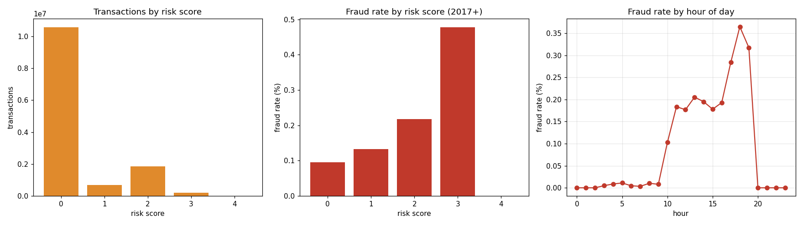

# Credit Card Fraud Detector

Scores 13.3 million credit card transactions with three risk rules, flags the risky ones, and sorts them so the likeliest fraud lands at the top of a human review queue. It then checks the flags against the dataset's real fraud labels so the numbers below are measured, not guessed.

Built Jan - Feb 2026.



## How it scores

| Rule | Points |
|---|---|
| Amount is more than 2x that customer's average | +2 |
| Transaction between midnight and 5 AM | +1 |
| Merchant category in the top quarter by fraud rate | +1 |

A score of 2 or more goes to review. The review queue is sorted by score, then amount.

To keep the check honest, the high-risk categories are learned only from transactions **before 2017**, and the results below are measured only on **2017 onward**.

## Results (2017+, 2.65M labeled transactions, 0.119% fraud)

| Risk score | Fraud rate | vs. base rate |
|---|---|---|
| 0 | 0.096% | 0.8x |
| 1 | 0.133% | 1.1x |
| 2 | 0.217% | 1.8x |
| 3 | 0.478% | 4.0x |

- Flagged transactions catch **30.3%** of all fraud
- A flag is **2x** as likely to be fraud as a random transaction; a score-3 flag is **4x**
- Full run on 13,305,915 transactions takes about a minute on a laptop

**What the data said back:** the midnight-5 AM rule is a common fraud heuristic, but in this dataset fraud clusters between 10 AM and 7 PM and is almost absent overnight (right chart). The amount and merchant-category rules carry the signal; the night rule mostly adds noise.

Simple rules get you a usable review order, but the precision is low. The next step is a trained model (gradient boosting on the same features plus merchant and card history) using these rules as the baseline to beat.

## Data

[Financial Transactions Dataset: Analytics](https://www.kaggle.com/datasets/computingvictor/transactions-fraud-datasets) on Kaggle. Download it and put these in `data/`:

- `transactions_data.csv`
- `mcc_codes.json`
- `train_fraud_labels.json`

## Run

```
pip install -r requirements.txt
python fraud_detector.py            # or: python fraud_detector.py path/to/data
```

Outputs go to `output/`: `review_queue.csv` (flagged transactions, riskiest first) and `summary.json` (the metrics above).

## Stack

Python, pandas, NumPy, matplotlib.
